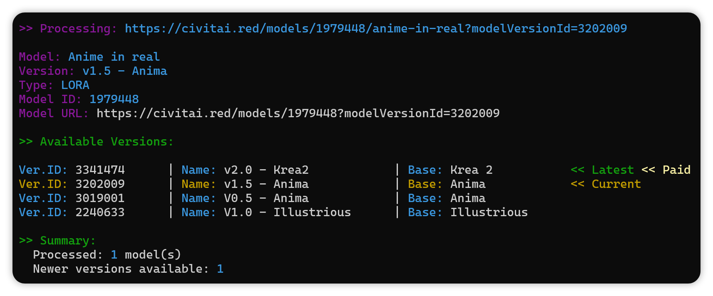

<div align="center">
  <h1>CivitAI Model Information Fetcher</h1>
  
</div>

> [!Note]
> **This script was primarily written for personal use with the help of AI.**</br>
> _Since I don't really care about its elegance (as long as it works :33), the code is written accordingly!_</br>
> Please note: THIS script does not work directly with models, but rather with DATA recorded in files.

## Features

- 🔍 **Multi-format Input** — URLs, model IDs, file hashes, JSON / Python / TXT files
- 🚀 **Concurrent fetching** — connection pooling + single-flight cache
- 🏷️ **Smart availability labels** — Public / Paid / Early Access (with days left)
- 📊 **JSON export** with optional filters by `baseModel` and `contenType`
- 🎨 **Colored console output** with dynamic column widths
- 🔑 **API key management** (up to 5 keys, rotation)
- 📦 **by-hash lookup** — AutoV1 / AutoV2 / SHA256 / CRC32 / BLAKE3
- 📤 **`--json` mode** — raw API response for scripting

## Installation

```bash
git clone https://github.com/anxety-solo/civitai-model-fether
cd civitai-model-fetcher

pip install aiohttp
```

Get an API key at [CivitAI → Account Settings](https://civitai.red/user/account) _(optional for public metadata, required for gated content)_

## Usage

### Basic

```bash
# By URL
python civitai_fetcher.py https://civitai.red/models/12345

# By model ID
python civitai_fetcher.py 12345

# By file hash
python civitai_fetcher.py A5F58EB1C3

# Multiple inputs
python civitai_fetcher.py 12345 67890 https://civitai.red/models/999

# From file
python civitai_fetcher.py -f models.json
python civitai_fetcher.py -f models.py -d
python civitai_fetcher.py -f models.txt -u
```

### Advanced

```bash
# Combine sources
python civitai_fetcher.py url1 url2 -i 12345 A5F58EB1C3 -f models.json

# Export with filters
python civitai_fetcher.py -f models.txt --export --type LORA --base-model "SD 1.5" SDXL

# Raw JSON output
python civitai_fetcher.py 4384 --json

# Manage API keys
python civitai_fetcher.py -k

# File format help
python civitai_fetcher.py --show-help

# Verbose logging
python civitai_fetcher.py -i 23423 -v
```

## Command Line Options

| Option | Description |
|--------|-------------|
| `urls` | Input URLs, model IDs or hashes (positional) |
| `-i, --input` | Additional URLs / IDs / hashes |
| `-f, --file` | Path to model list (JSON / Python / TXT) |
| `-u, --show-url` | Show model page URLs in version table |
| `-d, --show-download` | Show download URLs in version table |
| `-k, --change-key` | Manage stored API keys |
| `-t, --token` | Use this API key for the current run only |
| `--json` | Print raw API response as JSON |
| `--export [FILE]` | Export to JSON (default: timestamped file) |
| `--base-model ...` | Filter export by baseModel values |
| `--type ...` | Filter export by model type values |
| `--show-help` | Show supported file format examples |
| `-v, --verbose` | Enable debug logging |

## Input File Formats

### JSON

```json
{
    "My Models": [
        {"url": "https://civitai.red/models/1234", "name": "model1.safetensors"}
    ]
}
```

### Python catalog (any nesting)

```python
SD = {
    "model": {
        "Model Anime": [
            {"url": "https://civitai.red/api/download/models/5678", "name": "anime.safetensors"}
        ]
    },
    "vae": {}
}

MODEL_CATEGORIES = {"SD": SD}
```

### Text

```text
https://civitai.com/models/1234
https://civitai.green/models/5678 model1.safetensors
https://civitai.red/api/download/models/9012, https://civitai.com/models/3456
```

## Export Structure

```json
{
    "model_id": 1234,
    "model_name": "Anime",
    "model_type": "Checkpoint",
    "url": "https://civitai.red/models/1234",
    "versions": [
        {
            "version_id": 5678,
            "version_name": "v1.0",
            "created_at": "...",
            "updated_at": "...",
            "download_url": "https://civitai.red/api/download/models/9012",
            "early_access": false,
            "size": "6.5 GB",
            "base_model": "Illustrious",
            "trained_words": [],
            "url": "https://civitai.red/models/1234?modelVersionId=5678"
        }
    ]
}
```

## Configuration

The script creates a `data/` directory:

| Path | Purpose |
|------|---------|
| `data/config.json` | Stored API keys |
| `data/exports/` | Exported JSON files |

API keys can also be supplied via:

- `-t / --token` (one-shot)
- Environment variable `CIVITAI_API_KEY` (comma-separated for multiple)
